<h3 align="center">
  
  Stack
</h3>

<h3 align="center">
  
  Projects
</h3>

<h4 align="center">For More Projects 👉🏼 <a href="https://github.com/Amine4jh?tab=repositories">My Repositories</a></h4>

<h3 align="center">
  
  Trophies
</h3>

<h3 align="center">
  
  Stats
</h3>

  
  

<h3 align="center">
  
  Connect With Me
</h3>

